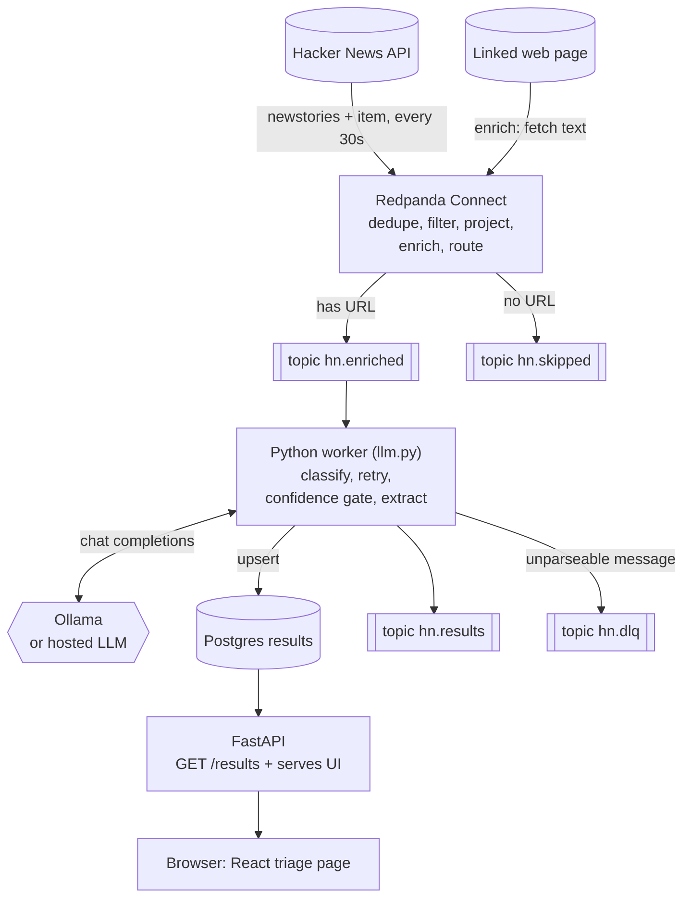
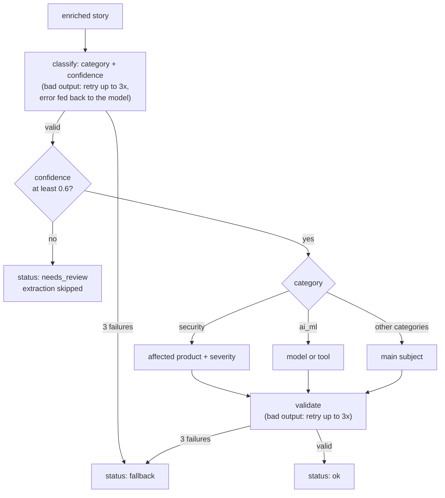
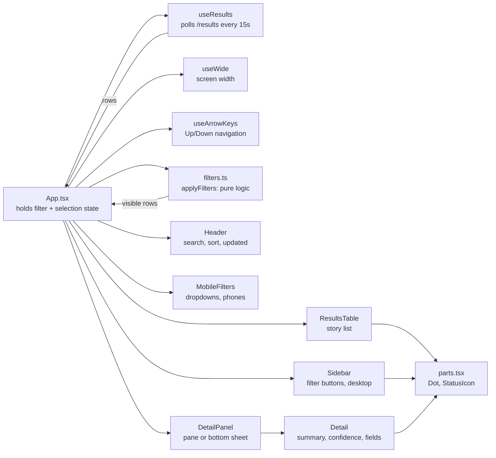

# HN story triage

Pipeline: Hacker News `newstories` -> **Redpanda Connect** (dedupe, fetch item, filter, project, fetch linked page, route) -> topic `hn.enriched` -> **Python service** (LLM classify -> category-specific extraction, retries, confidence gate) -> Postgres `results` + topic `hn.results` -> web page / JSON.

## Run

Needs Docker. No API keys: it uses a local Ollama model (`qwen2.5:1.5b`, ~1 GB download on first run).

```bash
docker compose up --build
```

- Page: http://localhost:8000/  (auto-refreshes; first results appear after the model downloads, about a minute or two)
- Diagrams (same as below, rendered in the app): http://localhost:8000/#diagrams
- JSON: http://localhost:8000/results?status=needs_review&limit=50
- Optional offline seed data (4 stories, no internet needed for the LLM step): `docker compose --profile seed run --rm seed`
- Hosted model: copy `.env.example` to `.env` and set `LLM_BASE_URL`, `LLM_MODEL`, `LLM_API_KEY` (any OpenAI-compatible endpoint).
- UI dev with hot reload (needs Node 20+): `cd frontend && npm install && npm run dev` (proxies `/results` to :8000)
- Tests: `cd service && pip install pytest && pytest`

## Layout

| Path | What |
|---|---|
| `connect/pipeline.yaml` | all Connect logic |
| `service/llm.py` | parsing, validation, retries, routing, confidence branch (pure, unit-tested) |
| `service/app.py` | Kafka worker + FastAPI (serves the built UI at `/`) |
| `frontend/` | React + Tailwind + shadcn/ui triage page; built inside the service image, no local Node needed |
| `db/schema.sql` | Postgres schema |
| `seed/stories.jsonl` | sample enriched records |

## How it fits together

Data flow (renders as a diagram on GitHub):



Decision logic inside the worker (`service/llm.py`):



Frontend components (`frontend/src/`):



## Behaviour worth knowing

- Dedupe is an in-memory Connect cache (24h) keyed on item id; the Postgres upsert on `id` makes restarts and replays safe.
- Pages that block the fetch (403 etc.) continue without content; the LLM then works from the title and logs a Connect error.
- `status`: `ok`, `needs_review` (confidence below 0.6, extraction skipped), `fallback` (model never produced valid output after 3 tries).
- If Ollama or Postgres is down, the worker retries the same message and does not commit its offset, so nothing is lost.

## Write-up

TODO (write this yourself, without AI, per the exercise): Tradeoffs, Surprises and production risks, Why this matters.
